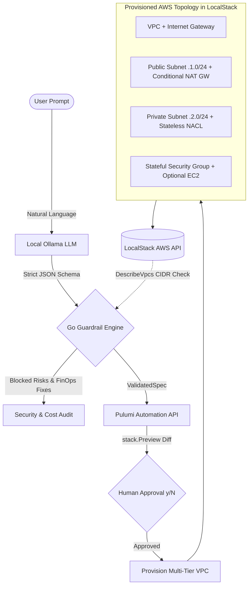

# Demo AI agent for Infrastructure  (Go + Local Ollama + Pulumi + LocalStack)

A local-first, guardrailed AI platform engineering agent written in **Golang**. It translates natural language infrastructure requests into safe, compliant AWS VPC topologies using **Ollama Structured Outputs**, enforces deterministic networking and security policies via **`net/netip`**, and provisions resources declaratively via the **Pulumi Automation API** against **LocalStack**.

---

## Architecture


---

## Project Structure

```text
demo-agent-vpc/
├── cmd/agent/main.go                  # CLI flags, audit summary renderer, & [y/N] approval gate
├── internal/
│   ├── llm/ollama_parser.go           # Ollama /api/chat client enforcing strict JSON Schema output
│   ├── policy/
│   │   ├── guardrail.go               # Deterministic security, FinOps, & net/netip subnet carver
│   └── provisioner/
│       ├── aws_discovery.go           # Live LocalStack VPC CIDR inspection via aws-sdk-go-v2
│       └── pulumi_runner.go           # Inline Pulumi Go program with local state backend
└── Makefile                           # Convenience targets ( run, destroy)
```

---

## Deterministic Guardrails (Security, Networking & FinOps)

Every LLM output is treated as untrusted input and passed through deterministic Go policies before touching cloud APIs:

| Guardrail Category | Policy Enforced in Go | Example Automatic Remediation |
| :--- | :--- | :--- |
| **Perimeter Security** | Blocks SSH (`22`), RDP (`3389`), PostgreSQL (`5432`), and MySQL (`3306`) from Security Groups and enforces a stateless **Network ACL** explicitly denying ports `22` & `3389`. | Strips port `22` and advises using AWS SSM Session Manager instead. |
| **Live CIDR Collision** | Queries existing VPCs via `DescribeVpcs` and checks overlaps with `net/netip`. | Shifts colliding `10.10.0.0/16` automatically to the next free `/16` block (`10.11.0.0/16`). |
| **Multi-Tier Subnetting** | Carves two isolated `/24` subnets from the validated VPC prefix using `net/netip`. | Allocates `.1.0/24` for NAT egress and `.2.0/24` for private compute (`MapPublicIpOnLaunch: false`). |
| **FinOps Cost Control** | Skips Elastic IP & NAT Gateway creation when no private compute instance is deployed, and restricts EC2 sizes to `t3.nano`, `t3.micro`, or `t3.small`. | Downgrades `m5.4xlarge` to `t3.micro`; skips idle NAT Gateway on network-only runs. |
| **Human-in-the-Loop** | Executes native `stack.Preview()` before mutating state. | Displays full Pulumi resource diff and requires explicit `[y/N]` confirmation. |

---


---

### Prerequisites
* Go 1.22+
* [LocalStack](https://www.localstack.cloud/localstack-open-source)
* [Pulumi CLI](https://pulumi.com)
* [Ollama](https://ollama.com) with a local model pulled (`ollama pull qwen2.5:1.5b`)

---

### 1. Check Makefile for building Go binaries, examples, etc
```
Before using make commands, run "go mod init demo-agent-vpc" and "go mod tidy" in the root directory of the project.
In case of errors, check your go env. Make sure GO111MODULE is set to "on".
```


### 2. Example Deploy via Natural Language Prompt

```bash
$ go run ./cmd/agent -prompt "Deploy an m5.4xlarge server in 10.10.0.0/16 and open port 22 and 443"

1. Parsing intent via Ollama (qwen2.5:1.5b)...
2. Inspecting live LocalStack VPC state & running Go guardrails...

==========================================
           DEMO AGENT AND NAT          
==========================================
  [BLOCKED]  SSH (port 22) blocked — use AWS SSM Session Manager instead of open SSH
  [ADJUSTED] CIDR 10.10.0.0/16 overlapped with an existing VPC — auto-shifted to 10.11.0.0/16
  [ADJUSTED] Instance type "m5.4xlarge" exceeds policy quota — downgraded to "t3.micro"

--- Final Approved Topology ---
  Stack Name:      dev-vpc
  VPC CIDR:        10.11.0.0/16 (requested: 10.10.0.0/16)
  Public Subnet:   10.11.1.0/24 (NAT egress tier)
  Private Subnet:  10.11.2.0/24 (isolated compute tier)
  Instance Type:   t3.micro (requested: m5.4xlarge)
  NAT Gateway:     true
  Allowed Ports:   [443]
==========================================

3. Running Pulumi Preview against LocalStack...
Approve and deploy this guardrailed architecture to LocalStack? [y/N]: y
```

---


### 3. Tear Down a Stack from Terminal
```bash
go run ./cmd/agent -destroy -stack dev-vpc
```
