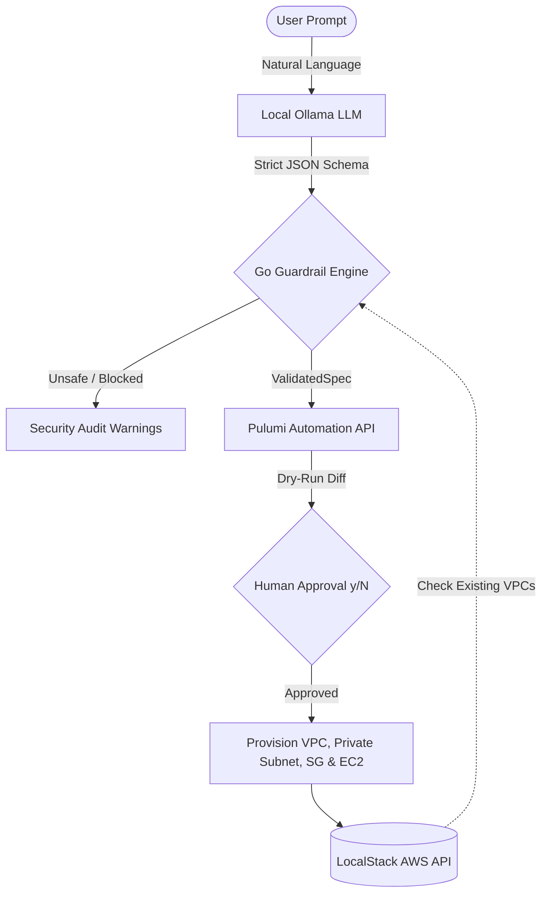

# Demo AI agent for Infrastructure  (Go + Local Ollama + Pulumi + LocalStack)

A local-first, guardrailed AI platform engineering agent written in **Golang**. It translates natural language infrastructure requests into safe, compliant AWS VPC topologies using **Ollama Structured Outputs**, enforces deterministic networking and security policies via **`net/netip`**, and provisions resources declaratively via the **Pulumi Automation API** against **LocalStack**.


---

## Architecture


## Security & Policy Guardrails

Non-expert users can request infrastructure via plain English without risking misconfigurations:
* **Zero Open Admin/DB Ports:** Automatically blocks SSH (`22`), RDP (`3389`), PostgreSQL (`5432`), and MySQL (`3306`) from Security Group ingress rules.
* **Live CIDR Collision Prevention:** Queries existing VPCs via `DescribeVpcs` and uses `net/netip` to detect overlaps, automatically shifting to the next available `/16` RFC1918 block.
* **Private-by-Default Networking:** Carves an isolated `/24` private subnet (`MapPublicIpOnLaunch: false`) and scopes Security Group ingress strictly to the internal VPC CIDR.
* **Instance Quota Enforcement:** Downgrades oversized instance requests (e.g., `m5.4xlarge`) to approved development sizes (`t3.nano`, `t3.micro`, `t3.small`).
* **Human-in-the-Loop Dry-Run:** Executes `stack.Preview()` before mutating state and requires explicit terminal confirmation.

---

## Project Structure

```text
demo-agent-vpc/
├── cmd/agent/main.go                  # CLI flags, audit summary renderer, & [y/N] approval gate
├── internal/
│   ├── llm/ollama_parser.go           # Ollama /api/chat client enforcing strict JSON Schema output
│   ├── policy/
│   │   ├── guardrail.go               # Deterministic security, FinOps, & net/netip subnet carver
│   │   └── guardrail_test.go          # Table-driven unit tests for policy & CIDR edge cases
│   └── provisioner/
│       ├── aws_discovery.go           # Live LocalStack VPC CIDR inspection via aws-sdk-go-v2
│       └── pulumi_runner.go           # Inline Pulumi Go program with local state backend
└── Makefile                           # Convenience targets ( run, destroy)
```
---

## Quickstart

### Prerequisites
* Go 1.22+
* [LocalStack](https://www.localstack.cloud/localstack-open-source)
* [Pulumi CLI](https://pulumi.com)
* [Ollama](https://ollama.com) with a local model pulled (`ollama pull qwen2.5:1.5b`)

### 1. Check Makefile for building Go binaries, examples, etc
```
Before using make commands, run "go mod init demo-agent-vpc" and "go mod tidy" in the root directory of the project.
In case of errors, check your go env. Make sure GO111MODULE is set to "on".
```
### 2. Deploy via Natural Language Prompt
```bash
$ go run ./cmd/agent  \
        -prompt "Deploy a VPC named single-lab in 10.60.0.0/16 with an t3.small and port 443 open"
1. Parsing intent via Ollama (qwen2.5:1.5b)...
2. Inspecting live LocalStack VPC state & running Go guardrails...

==========================================
           DEMO VPC AI INFRA AGENT
==========================================
  [ADJUSTED] Direct public IP assignment requested — use an ALB/NAT for ingress

--- Final Approved Topology ---
  Stack Name:    single-lab
  VPC CIDR:      10.60.0.0/16 (requested: 10.60.0.0/16)
  Subnet CIDR:   10.60.1.0/24 (private)
  Instance Type: t3.small (requested: t3.small)
  Allowed Ports: [443]
==========================================

3. Running Pulumi Preview against LocalStack...
Previewing update (single-lab):

 +  pulumi:pulumi:Stack vpc-demo-single-lab create
@ previewing update.....
 +  aws:ec2:Vpc demo-vpc create
 +  aws:ec2:Subnet demo-subnet create
 +  aws:ec2:SecurityGroup demo-sg create
 +  aws:ec2:Instance demo-instance create
 +  pulumi:pulumi:Stack vpc-demo-single-lab create
Outputs:
    instanceId     : [unknown]
    securityGroupId: [unknown]
    subnetId       : [unknown]
    vpcId          : [unknown]

Resources:
    + 5 to create
```

### 3. Tear Down Stack
```bash
go run ./cmd/agent -destroy -stack dev-vpc
```

